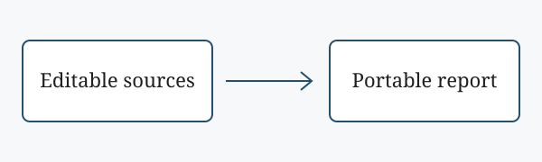

## Introduction {#sec:introduction}

A report should remain easy to revise while producing a stable document for
submission. This sample evaluates a local publishing workflow in which text,
metadata and references are stored separately. Knap assembles the sources
[@knap], while Pandoc handles document conversion and citations [@pandoc].
Replace this discussion with the purpose and scope of your own investigation.
The workflow is described in @sec:workflow and assessed in @sec:evaluation.

{#fig:overview}

## Workflow {#sec:workflow}

As @fig:overview illustrates, the submitted document is an output rather than
the primary working file. [@fig:pipeline] shows the stages recorded in
`project.json`. Each stage can be repeated locally without uploading the
manuscript to a publishing service.

``` {.mermaid #fig:pipeline caption="The report publishing pipeline"}
flowchart TD
  S[Source: report.md] --> T[Template: Knap 0.4.2]
  D[Data: project.json] --> T
  T --> R[Render: Node.js]
  R --> M[build/report.md]
  M --> P[Publish: Pandoc]
  P --> H[build/report.html]
  H --> C[Headless Chromium]
  C --> F[build/report.pdf]
```

### Reproducibility {#sec:reproducibility}

The commands in @lst:build recreate the report. This makes it possible to
check the result after changing a source file. The roles in @tbl:stages
separate authoring decisions from the publishing tools.

| Input | Responsibility |
|:------|:---------------|
| Manuscript | Argument, evidence and interpretation |
| Metadata | Title page and bibliographic records |
| Templates | Consistent assembly of the document |

: Responsibilities within the workflow {#tbl:stages}

``` {.sh #lst:build caption="Build and inspect a submission"}
npm run check
npm test
npm run html
npm run pdf
```

## Evaluation {#sec:evaluation}

A simple completeness measure is the proportion of required checks that
pass. @eq:coverage defines this measure, where $p$ is the number passed and
$n$ is the total number of checks. It describes procedural completeness;
it does not measure the quality of the argument.

$$
C = \frac{p}{n} \times 100
$$ {#eq:coverage}

For example, passing nine of ten checks gives a completeness score of 90%.
The author should still inspect captions, references and page breaks before
submission. @sec:reproducibility explains how to repeat the technical checks.
Together, the two publishing tools support a compact workflow [@knap; @pandoc].

## Conclusion {#sec:conclusion}

The approach described in @sec:introduction keeps the report editable and
its outputs reproducible. Replace the sample material, figures and references
with evidence relevant to your assignment, then inspect the final PDF against
the module's submission requirements.

## References {.unnumbered}

::: {#refs}
:::

## Appendix: Build pipeline {.unnumbered}

<!-- GENERATED_BUILD_APPENDIX -->
